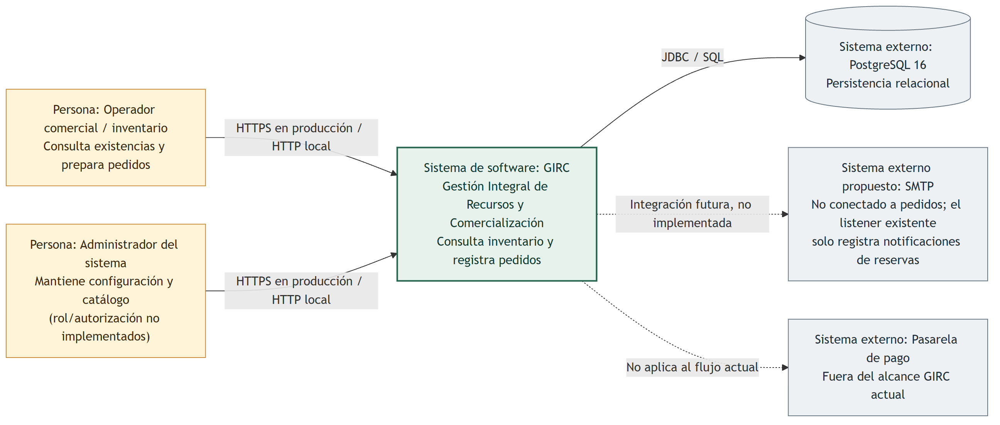
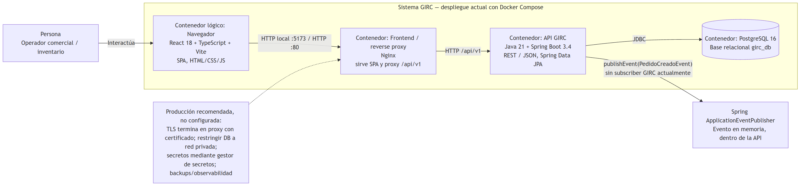
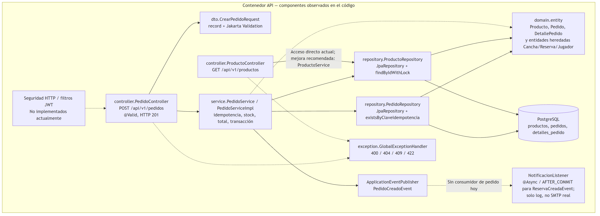
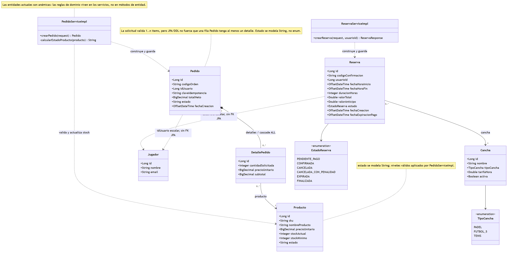
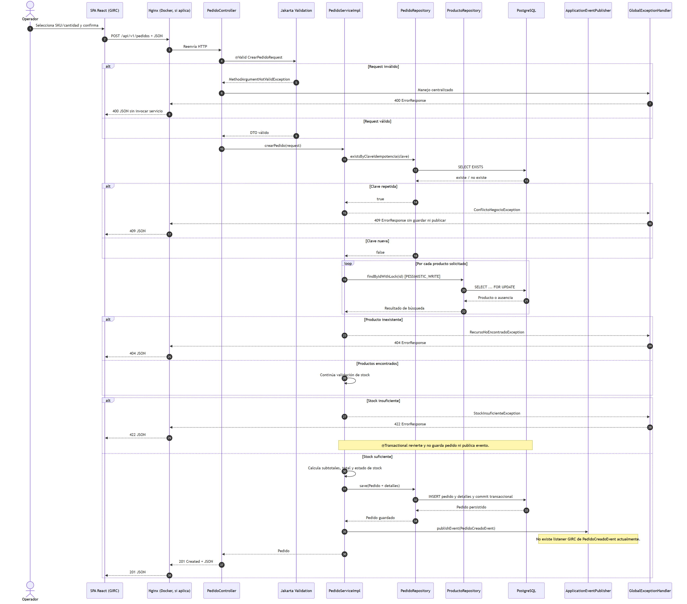
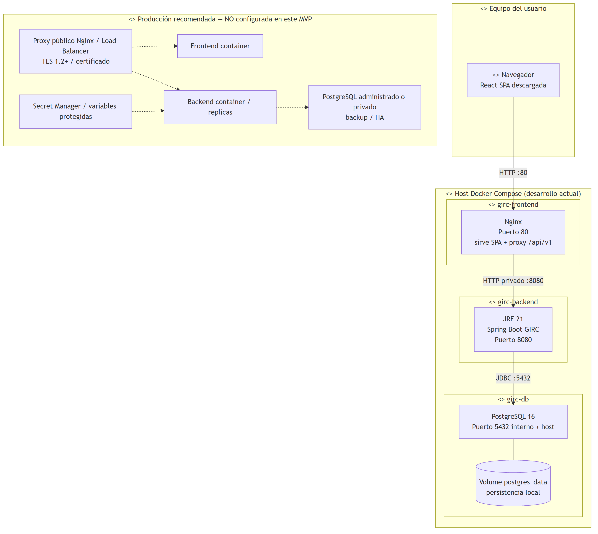

# Documento Maestro — Parcial 2

## GIRC
### Sistema de Gestión Integral de Recursos y Comercialización

**Asignatura:** [Completar] 
**Docente:** [Completar] 
**Integrantes:** [Completar nombres del equipo] 
**Institución:** [Completar] 
**Fecha:** 21 de noviembre de 2026 
**Repositorio:** [Liz010713/GIRC](https://github.com/Liz010713/GIRC)

> Este documento describe la implementación y la arquitectura verificadas en el repositorio. Los elementos marcados como *propuestos*, *brecha* o *no implementados* no deben presentarse como funcionalidad existente.

## 1. Resumen ejecutivo

GIRC es una aplicación web para consultar inventario y registrar pedidos. La SPA React consulta productos desde Spring Boot, permite seleccionar artículos y enviar un pedido. El backend valida idempotencia, bloquea filas de productos, comprueba existencias, calcula subtotales y total, actualiza el estado del stock, persiste pedido/detalles y publica un evento de aplicación.

El estilo adoptado es **monolito modular con arquitectura en capas**. El repositorio conserva clases de reservas del proyecto formativo original como módulo heredado; la interfaz principal y la identidad visible ahora corresponden a GIRC.

## 2. Alcance actual y evidencia

| Capacidad | Evidencia actual |
|---|---|
| Consultar inventario | `GET /api/v1/productos`, `ProductoController`, `ProductoRepository.findAll()` |
| Crear pedido | `POST /api/v1/pedidos`, `PedidoController`, `PedidoServiceImpl` |
| Validación de entrada | `CrearPedidoRequest` con `@NotNull`, `@NotBlank`, `@NotEmpty`, `@Valid`, `@Min(1)` |
| Idempotencia | `PedidoRepository.existsByClaveIdempotencia()` y UNIQUE en columna |
| Concurrencia de stock | `@Transactional` y `findByIdWithLock()` con `PESSIMISTIC_WRITE` |
| Errores HTTP | `GlobalExceptionHandler`: 400, 404, 409 y 422 |
| Eventos | Se publica `PedidoCreadoEvent`; aún no existe listener de pedido |
| Notificaciones | El listener heredado de reservas solo escribe log; no hay SMTP real |
| Seguridad | No hay autenticación/autorización implementada; no desplegar API abierta |
| Integraciones de pago | No forman parte del flujo actual de GIRC |

## 3. Justificación del estilo arquitectónico

### Estilo seleccionado: monolito modular en capas

El backend es una aplicación Spring Boot única, separada en `controller`, `service`, `repository`, `domain.entity`, `dto` y `exception`. React se despliega como SPA y se comunica con la API mediante HTTP/JSON. PostgreSQL es un contenedor separado.

Se elige este estilo para el alcance formativo porque mantiene una transacción atómica para consultar y actualizar stock, simplifica pruebas con JUnit/Mockito/MockMvc/H2 y hace explícitas las responsabilidades. Microservicios añadirían coordinación de transacciones y despliegue sin una necesidad demostrada. Hexagonal/Clean sería viable si aumentan integraciones, pero hoy no hay puertos/adaptadores definidos.

### Relación con atributos de calidad

| Atributo | Mecanismo actual | Evidencia / riesgo |
|---|---|---|
| Integridad/concurrencia (RNF-02) | `@Transactional`, bloqueo `PESSIMISTIC_WRITE`, UNIQUE de clave idempotente | No hay benchmark ni prueba de concurrencia real en PostgreSQL; riesgo de contención/deadlock con pedidos multítem |
| Rendimiento | Índices compuestos de reservas; React filtra catálogo en cliente | Catálogo usa `findAll()` sin paginación; P95 no medido |
| Seguridad | Validación de entrada, manejo central de errores, parámetros JPA | No existe SecurityFilterChain, JWT ni control por rol; CORS permite `*` |
| Mantenibilidad (RNF-05) | Interfaces de servicio/repository y DTO de entrada | `ProductoController` accede directo al repository; controllers de pedido devuelven entidades JPA |
| Resiliencia/eventos | `ApplicationEventPublisher`; listener de reserva async AFTER_COMMIT | `PedidoCreadoEvent` no tiene consumidor y Spring event en memoria no es durable |
| Despliegue | Docker Compose para DB, API y Nginx | Compose describe entorno local; proxy TLS, backups y monitoreo de producción no están configurados |

## 4. Modelo C4

Los seis diagramas editables están en [`diagrams/`](diagrams/). La versión para lectura/render en GitHub está en [Diagramas del Parcial 2](diagramas.md).

### Nivel 1 — Contexto

Sistema central GIRC, operador comercial/inventario y administrador como actores conceptuales. PostgreSQL es dependencia real. SMTP se muestra como sistema propuesto/no conectado para GIRC; una pasarela de pago se declara fuera del flujo actual. La autenticación de roles no está implementada.

Fuente: [`c4-contexto.mmd`](diagrams/c4-contexto.mmd).

### Nivel 2 — Contenedores

Navegador con React/TypeScript, Nginx como servidor SPA/proxy, API Java 21/Spring Boot y PostgreSQL 16. Comunicación local HTTP, API JSON y JDBC. La sección de producción del dibujo se etiqueta expresamente como recomendación, no como despliegue existente.

Fuente: [`c4-contenedores.mmd`](diagrams/c4-contenedores.mmd).

### Nivel 3 — Componentes del backend

Se muestran controllers, DTO, service, repositories, entidades, manejo global de errores y evento de aplicación. No se dibuja un filtro JWT como existente: se marca como brecha. También se hace visible que `ProductoController` consulta el repository directamente.

Fuente: [`c4-componentes-backend.mmd`](diagrams/c4-componentes-backend.mmd).

## 5. UML esencial

### Clases de dominio

El diagrama cubre entidades GIRC y las entidades de reservas que permanecen en la plantilla. Cardinalidades reales: `Pedido 1 — 0..N DetallePedido`, `DetallePedido N — 1 Producto`, `Reserva N — 1 Cancha`. `idUsuario`/`usuarioId` son escalares sin FK a `Jugador`. `Pedido.estado` y `Producto.estado` son strings, no enums. La lista de items del request exige 1..n en API, pero la BD no impone la existencia de hijos.

Las entidades son anémicas en el código actual: `crearPedido()` y `calcularEstadoProducto()` residen en `PedidoServiceImpl`; `crearReserva()` reside en `ReservaServiceImpl`. El diagrama muestra estas operaciones donde son implementadas, sin atribuirlas a las entidades.

Fuente: [`uml-clases-dominio.mmd`](diagrams/uml-clases-dominio.mmd).

### Secuencia Full Stack de crear pedido

El flujo incluye validación 400, idempotencia 409, producto ausente 404, stock insuficiente 422, camino válido, bloqueo de producto, persistencia y respuesta 201. En el camino 422 la transacción revierte y no se guarda ni publica evento. La publicación del evento no tiene subscriber GIRC hoy.

Fuente: [`uml-secuencia-crear-pedido.mmd`](diagrams/uml-secuencia-crear-pedido.mmd).

### Despliegue

El entorno reproducible actual es Docker Compose: Nginx, API y PostgreSQL con volumen local. El diagrama distingue una propuesta de producción con TLS, secretos externos y PostgreSQL protegido; no se afirma que exista un VPS/cloud desplegado.

Fuente: [`uml-despliegue.mmd`](diagrams/uml-despliegue.mmd).

## 6. Persistencia y ORM

El diccionario detallado con tipo SQL, restricciones, claves, índices, significado y mapeo se encuentra en [`persistencia/diccionario-datos.md`](persistencia/diccionario-datos.md).

Buenas prácticas presentes: PK identity; SKU/código/idempotencia únicos; FK para detalles y cancha de reserva; `BigDecimal` en importes GIRC; `@Enumerated(EnumType.STRING)` en estados/tipos del módulo de reserva; `FetchType.LAZY` en relaciones Reserva-Cancha, Pedido-Detalles y Detalle-Pedido. Excepción detectada: `DetallePedido.producto` omite `fetch`, por lo que JPA lo deja EAGER.

`ddl-auto=update` es cómodo en desarrollo, pero para producción se recomienda Flyway/Liquibase. Validar FKs, CHECKs e índices en PostgreSQL real; H2 es evidencia de tests, no sustituto de todas las pruebas de dialecto.

## 7. Diseño limpio y patrones

### Responsabilidades/SOLID observables

- **SRP:** `PedidoController` recibe HTTP; `PedidoServiceImpl` aplica reglas; repositories aíslan acceso a datos; `GlobalExceptionHandler` traduce excepciones.
- **DIP:** servicios reciben interfaces repository y `ApplicationEventPublisher` por constructor (`@RequiredArgsConstructor`).
- **DTO:** `CrearPedidoRequest` y su tipo `Item` aíslan y validan el contrato de entrada.
- **Repository:** `PedidoRepository`/`ProductoRepository` abstraen persistencia; Spring Data genera operaciones CRUD.
- **Observer/Event:** `PedidoServiceImpl` publica `PedidoCreadoEvent`. El patrón de publicación existe, pero falta un listener específico de pedidos.
- **Transacción:** `@Transactional` mantiene actualización de stock y creación de pedido en una unidad atómica.

### Brechas recomendadas antes de llamarlo listo para producción

1. Crear `ProductoService` para que `ProductoController` no dependa directamente del repository.
2. Definir DTO de respuesta de pedido/producto y evitar serializar entidades JPA directamente.
3. Declarar `DetallePedido.producto` como `FetchType.LAZY` y probar serialización con OSIV apagado.
4. Implementar seguridad (OIDC/JWT/roles), restringir CORS y no confiar en `idUsuario` del body.
5. Añadir listener de `PedidoCreadoEvent` o retirar el evento si no se consume; usar Outbox si se exige durabilidad.
6. Añadir migraciones de esquema, paginación de productos, índices medidos y pruebas de concurrencia PostgreSQL.

## 8. Registros de decisiones (ADRs)

1. [ADR-001 — Monolito modular en capas](adr/ADR-001-monolito-modular-en-capas.md)
2. [ADR-002 — Transacciones y bloqueo pesimista](adr/ADR-002-transacciones-y-bloqueo-pesimista.md)
3. [ADR-003 — PostgreSQL y JPA](adr/ADR-003-postgresql-y-jpa.md)
4. [ADR-004 — Seguridad y autenticación](adr/ADR-004-seguridad-y-autenticacion.md) (propuesta / brecha)

## 9. Pruebas y evidencia

En la última validación registrada del repositorio se ejecutaron **21 pruebas backend, 0 fallidas, `BUILD SUCCESS`**. El frontend pasó `npm ci` y `npm run build`. Las pruebas cubren servicio de pedidos, MockMvc, reglas de reservas heredadas y `@DataJpaTest` con H2 para solapamiento parcial, contigüidad y cancelación.

La cobertura no representa una prueba de carga, seguridad, concurrencia real de PostgreSQL, integración SMTP ni despliegue TLS. Añadir evidencia si se ejecutan esas pruebas en el entorno del equipo.

## 10. Cómo presentar el trabajo, paso a paso

1. Presentar GIRC y delimitar actores: operador comercial/inventario y administrador conceptual; explicar que los roles aún no se autentican.
2. Explicar por qué se eligió un monolito modular por capas y cómo una transacción protege el flujo de pedido.
3. Recorrer C4 Contexto: quién usa el sistema y qué dependencia real existe; aclarar que SMTP y pagos no forman una integración GIRC actual.
4. Recorrer C4 Contenedores: SPA, Nginx, API y PostgreSQL; separar desarrollo local de propuesta productiva.
5. Recorrer Componentes: request validado, controller, service, repositories, entidades y handler; mencionar el acceso directo del controller de producto como mejora pendiente.
6. Leer el UML de clases y explicar las cardinalidades, las FKs reales y los IDs de usuario escalares.
7. Narrar la secuencia de pedido y detenerse en los `alt`: 400, 409, 404, 422 y 201.
8. Explicar el diccionario de datos, unicidad de idempotencia, FKs, precisión monetaria e índices heredados de reservas.
9. Presentar ADRs como decisiones con alternativas y trade-offs, no como descripción genérica.
10. Cerrar con evidencia: `mvn test`, build frontend y brechas de producción declaradas.

## 11. Lista de entrega del equipo

- [ ] Completar integrantes, curso, docente e institución en esta portada.
- [ ] Revisar términos y alcance contra las historias de usuario y OpenAPI aprobados por el profesor.
- [ ] Revisar la sección de brechas con el equipo; no presentar pagos, autenticación, SMTP real o TLS como existentes.
- [ ] Exportar este documento y la página de diagramas a PDF/Word desde un editor compatible si la plataforma exige ese formato. Los fuentes editables Mermaid permanecen bajo `docs/hito-2/diagrams/`.
- [ ] Adjuntar capturas de las pruebas/CI si las solicitan.

# Anexo A - Diagramas renderizados

## C4 Level 1 - Context

{width=6.3in}

## C4 Level 2 - Containers

{width=6.3in}

## C4 Level 3 - Backend components

{width=6.3in}

## UML - Domain classes

{width=6.3in}

## UML - Full Stack order sequence

{width=6.3in}

## UML - Deployment

{width=6.3in}

# Anexo B - Diccionario de datos

# Diccionario de datos y mapeo JPA

**Motor objetivo:** PostgreSQL 16. Los tipos SQL corresponden al mapeo PostgreSQL habitual de Hibernate 6. El DDL definitivo debe verificarse con migraciones antes de producción. La aplicación usa actualmente `spring.jpa.hibernate.ddl-auto=update`; no hay Flyway/Liquibase ni scripts versionados de migración.

## Tablas GIRC: inventario y pedidos

### `productos`
Entidad `com.courtsync.pro.domain.entity.Producto`.

| Columna | Tipo SQL | Restricciones observadas | ORM / descripción |
|---|---|---|---|
| `id` | `BIGINT` | PK, identity | `@Id`, `@GeneratedValue(IDENTITY)` |
| `sku` | `VARCHAR(50)` | NOT NULL, UNIQUE | Código comercial, `@Column(unique=true)` |
| `nombre_producto` | `VARCHAR(150)` | NOT NULL | Nombre visible |
| `precio_unitario` | `NUMERIC(12,2)` | NOT NULL; `@DecimalMin("0.0")` | `BigDecimal`, precio unitario |
| `stock_actual` | `INTEGER` | NOT NULL; `@Min(0)` | Existencias disponibles |
| `stock_minimo` | `INTEGER` | NOT NULL; `@Min(1)` | Umbral de alerta |
| `estado` | `VARCHAR(20)` | NOT NULL | `String`: Disponible, Crítico o Agotado; recalculado por service |

Índice único en `sku`. La consulta del catálogo hoy usa `findAll()` sin paginación.

### `pedidos`
Entidad `Pedido`.

| Columna | Tipo SQL | Restricciones observadas | ORM / descripción |
|---|---|---|---|
| `id` | `BIGINT` | PK, identity | Identificador |
| `codigo_orden` | `VARCHAR(40)` | NOT NULL, UNIQUE | Código `ORD-...` |
| `id_usuario` | `BIGINT` | NOT NULL, sin FK JPA | ID escalar aportado por request; no autentica identidad |
| `clave_idempotencia` | `VARCHAR(100)` | NOT NULL, UNIQUE | Evita reutilización de clave |
| `total_neto` | `NUMERIC(12,2)` | NOT NULL | Suma de subtotales |
| `estado` | `VARCHAR(30)` | NOT NULL | `String`, estado inicial Pendiente; no enum |
| `fecha_creacion` | `TIMESTAMP WITH TIME ZONE` | NOT NULL | `OffsetDateTime` UTC |

Relación `Pedido 1 -> 0..N DetallePedido`, `@OneToMany(cascade=ALL, orphanRemoval=true)`. El request valida lista no vacía, pero el esquema no fuerza que toda orden tenga detalle.

### `detalles_pedido`
Entidad `DetallePedido`.

| Columna | Tipo SQL | Restricciones observadas | ORM / descripción |
|---|---|---|---|
| `id` | `BIGINT` | PK, identity | Identificador |
| `pedido_id` | `BIGINT` | NOT NULL, FK -> `pedidos.id` | `@ManyToOne(fetch=LAZY)` |
| `producto_id` | `BIGINT` | NOT NULL, FK -> `productos.id` | `@ManyToOne`; actualmente hereda EAGER por omitir `fetch` |
| `cantidad_solicitada` | `INTEGER` | NOT NULL | Unidades pedidas |
| `precio_unitario` | `NUMERIC(12,2)` | NOT NULL | Precio histórico al momento de compra |
| `subtotal` | `NUMERIC(12,2)` | NOT NULL | Precio por cantidad |

PostgreSQL no crea índices automáticamente sobre FKs. Evaluar índices en `pedido_id` y `producto_id` según consultas/volumen.

## Entidades heredadas de reservas

Se conservan para respetar la plantilla del curso; no son el flujo de inventario GIRC.

### `jugadores`

| Columna | Tipo SQL | Restricciones | Mapeo / significado |
|---|---|---|---|
| `id` | `BIGINT` | PK, identity | ID |
| `nombre` | `VARCHAR(120)` | NOT NULL | Nombre |
| `email` | `VARCHAR(160)` | NOT NULL, UNIQUE | Correo |

### `canchas`

| Columna | Tipo SQL | Restricciones | Mapeo / significado |
|---|---|---|---|
| `id` | `BIGINT` | PK, identity | ID |
| `nombre` | `VARCHAR(150)` | NOT NULL | Nombre |
| `tipo_cancha` | `VARCHAR(30)` | NOT NULL | `@Enumerated(STRING)`, `TipoCancha` |
| `tarifa_hora` | `DOUBLE PRECISION` | NOT NULL | Tarifa |
| `activa` | `BOOLEAN` | NOT NULL | Indicador activo |

### `reservas`

| Columna | Tipo SQL | Restricciones | Mapeo / significado |
|---|---|---|---|
| `id` | `BIGINT` | PK, identity | ID |
| `codigo_confirmacion` | `VARCHAR(30)` | NOT NULL, UNIQUE | Código de reserva |
| `cancha_id` | `BIGINT` | NOT NULL, FK -> `canchas.id` | `ManyToOne(fetch=LAZY)` |
| `usuario_id` | `BIGINT` | NOT NULL, sin FK JPA a jugadores | ID escalar |
| `fecha_hora_inicio` | `TIMESTAMP WITH TIME ZONE` | NOT NULL | Inicio |
| `fecha_hora_fin` | `TIMESTAMP WITH TIME ZONE` | NOT NULL | Fin |
| `duracion_horas` | `INTEGER` | NOT NULL | Duración |
| `valor_total` | `DOUBLE PRECISION` | NOT NULL | Importe heredado |
| `valor_anticipo` | `DOUBLE PRECISION` | NOT NULL | Importe heredado |
| `estado` | `VARCHAR(30)` | NOT NULL | `@Enumerated(STRING)`, `EstadoReserva` |
| `fecha_creacion` | `TIMESTAMP WITH TIME ZONE` | NOT NULL | Fecha creación |
| `fecha_expiracion_pago` | `TIMESTAMP WITH TIME ZONE` | NOT NULL | Expiración |

Índices compuestos declarados: `idx_reservas_cancha_inicio_estado (cancha_id, fecha_hora_inicio, estado)` para disponibilidad y `idx_reservas_usuario_inicio (usuario_id, fecha_hora_inicio)` para límite diario.

## Integridad y notas para producción

- Las anotaciones Jakarta Validation validan request/entidades, pero no se debe asumir que `ddl-auto=update` ha creado todos los CHECK constraints en bases existentes. Inspeccionar DDL real.
- FKs actuales: `detalles_pedido.pedido_id`, `detalles_pedido.producto_id`, `reservas.cancha_id`. Los IDs de usuario no tienen FK.
- Cambiar `ddl-auto=update` por migraciones versionadas para producción.
- DTOs de respuesta recomendados: `PedidoController` actualmente responde una entidad y `Pedido.detalles` es LAZY; comprobar serialización con `open-in-view=false`.
- GIRC usa `BigDecimal`; reservas heredadas aún usa `Double` para dinero.

# Anexo C - Trazabilidad RNF

# Trazabilidad de requisitos no funcionales

| RNF / requisito | Diseño actual | Evidencia verificable | Brecha / seguimiento |
|---|---|---|---|
| Concurrencia de inventario RNF-02 | `@Transactional` + `@Lock(PESSIMISTIC_WRITE)` en ProductoRepository | `PedidoServiceImpl`, tests de stock en `PedidoServiceTest` | Agregar prueba concurrente con PostgreSQL, bloqueo ordenado por ID, timeout y métrica |
| Rendimiento | Índices compuestos `reservas` y consulta agregada de disponibilidad | `ReservaRepository`, `ReservaRepositoryDataJpaTest` | `GET /productos` sin paginación; P95 no medido; planificar carga/EXPLAIN |
| Seguridad | Validación de request y `GlobalExceptionHandler` | `PedidoControllerTest` | No hay autenticación/autorización; CORS `*`; no publicar expuesto |
| Mantenibilidad | Paquetes controller/service/repository/domain/dto/exception | Interfaces `PedidoService`, `PedidoRepository`, DTO de entrada | `ProductoController` salta service; controller devuelve entidad Pedido |
| Resiliencia de evento | `ApplicationEventPublisher` para `PedidoCreadoEvent` | `PedidoServiceTest` verifica publish/never | Evento solo memoria y sin listener GIRC; Outbox/listener si requiere entrega durable |
| Persistencia | PostgreSQL + JPA, H2 en `@DataJpaTest` | `ReservaRepositoryDataJpaTest` | Integración de consultas de pedidos contra Postgres no creada; sin Flyway/Liquibase |
| Disponibilidad/despliegue | Docker Compose separa frontend, backend y DB | `docker-compose.yml` | No hay TLS, backup, healthchecks para API/frontend ni observabilidad productiva |

# Anexo D - Evidencia SOLID y patrones

# Evidencia de diseño limpio, SOLID y patrones

| Principio/patrón | Evidencia en código | Explicación | Estado |
|---|---|---|---|
| Single Responsibility | `PedidoController`, `PedidoServiceImpl`, repositorios, `GlobalExceptionHandler` | HTTP, reglas, persistencia y traducción de errores están en responsabilidades diferentes | Aplicado en pedido |
| Dependency Inversion | `PedidoService` y repositorios inyectados por constructor (`@RequiredArgsConstructor`) | Servicio depende de contratos Spring Data/interfaces, no crea dependencias concretas manualmente | Aplicado |
| DTO | `CrearPedidoRequest` como record con validaciones anidadas | Contrato de entrada desacoplado de validación de dominio | Aplicado en entrada; respuesta sigue exponiendo entidad |
| Repository | `PedidoRepository`, `ProductoRepository`, `ReservaRepository` | Abstracción de persistencia y consultas derivadas/JPQL | Aplicado |
| Observer / Event | `ApplicationEventPublisher` + `PedidoCreadoEvent`; `ReservaCreadaEvent` + `NotificacionListener` | Notifica publicación sin que el service invoque directamente un transporte externo | Parcial: no hay listener para eventos PedidoCreadoEvent; listener de reserva solo escribe log |
| Strategy | No se encontró una implementación Strategy en el estado actual | No afirmar que está aplicada; sería útil si aparecen políticas variables de precio/stock | No aplicado |
| Factory | No hay factory de dominio explícita | La creación se realiza con Lombok Builder en service | No aplicado como patrón Factory |

## Mejora concreta priorizada

Crear `ProductoService` para mover la consulta `findAll()` fuera de `ProductoController`, y crear `PedidoResponse`/`DetallePedidoResponse` para que la API no serialice entidades JPA directamente. Esta evolución mejora SRP, límites de contrato y control de carga lazy sin cambiar las reglas de negocio.

# Anexo E - ADRs

# ADR-001: Monolito modular con arquitectura en capas

- **Estado:** Aceptada
- **Fecha:** 2026-11-21

## Contexto y problema

GIRC es un MVP académico con un flujo transaccional de consulta de inventario y creación de pedidos. Se requiere separar la API, reglas de negocio y persistencia sin añadir infraestructura distribuida difícil de probar. La mantenibilidad pide aislar cambios de reglas; la integridad exige transacciones para pedido y stock.

## Alternativas evaluadas

1. Arquitectura en capas en un monolito modular.
2. Microservicios separados para catálogo, inventario y pedidos.
3. Arquitectura hexagonal/Clean completa con puertos y adaptadores.

## Decisión tomada

Adoptar un **monolito modular organizado en capas**. React es un cliente SPA separado y Spring Boot es el backend desplegable, que contiene módulos GIRC y clases de reservas heredadas.

## Consecuencias y trade-offs

- **Positivas:** despliegue y pruebas simples; una transacción JPA protege pedido y existencias; límites entendibles para el equipo.
- **Negativas:** el escalado se hace para toda la API; un despliegue afecta a todos los módulos; las capas no garantizan por sí solas bajo acoplamiento.
- **Desviación actual:** `PedidoController -> PedidoService -> repositories` respeta el flujo. `ProductoController` accede directamente a `ProductoRepository`; para aplicar estrictamente service layer debe introducirse `ProductoService`.
- No se declara arquitectura hexagonal: no existen puertos/adaptadores para persistencia, correo o pagos.

# ADR-002: Transacciones y bloqueo pesimista de existencias

- **Estado:** Aceptada
- **Fecha:** 2026-11-21

## Contexto y problema

Pedidos concurrentes podrían leer el mismo `stockActual` y vender unidades por encima de las disponibles. RNF-02 exige integridad; RN-02.1 exige HTTP 422 sin guardar ni publicar evento si el stock es insuficiente.

## Alternativas evaluadas

1. `@Transactional` + `PESSIMISTIC_WRITE` por producto.
2. Control optimista con `@Version`, conflictos y reintentos.
3. Actualización SQL condicional (`stock_actual >= cantidad`) y comprobar filas afectadas.

## Decisión tomada

`PedidoServiceImpl.crearPedido()` es `@Transactional`; consulta cada producto con `ProductoRepository.findByIdWithLock()` (`@Lock(PESSIMISTIC_WRITE)`), valida todas las líneas y después muta las entidades administradas, guarda pedido/detalles y publica `PedidoCreadoEvent`. Las excepciones runtime provocan rollback.

## Consecuencias y trade-offs

- **Positivas:** serializa escrituras sobre la fila de producto; el pedido y los detalles se escriben en la transacción; tests verifican no guardar/evento en stock insuficiente.
- **Negativas:** locks largos reducen concurrencia; pedidos multítem que toman filas en distinto orden pueden aumentar riesgo de deadlock; el publisher en memoria no es durable.
- **Mitigaciones recomendadas:** bloquear IDs en orden ascendente, definir timeout, medir contención y considerar Outbox si el evento debe sobrevivir a fallos.
- **Brecha:** no hay prueba concurrente de dos transacciones contra PostgreSQL; la cobertura de bloqueo se infiere de la anotación/repositorio y pruebas funcionales.

# ADR-003: PostgreSQL y Spring Data JPA

- **Estado:** Aceptada
- **Fecha:** 2026-11-21

## Contexto y problema

El sistema necesita relaciones referenciales entre pedidos, detalles y productos, unicidad de SKU/idempotencia y transacciones con bloqueo de filas. También se busca una base embebida para pruebas.

## Alternativas evaluadas

1. PostgreSQL + Spring Data JPA/Hibernate.
2. MySQL/MariaDB + JPA.
3. Base documental con consistencia de stock gestionada por aplicación.

## Decisión tomada

PostgreSQL 16 para ejecución con Docker Compose y Spring Data JPA para persistencia. H2 se usa con `@DataJpaTest`. Las entidades declaran PK, `UNIQUE`, `NOT NULL`, FKs e índices de las consultas heredadas de reservas.

## Consecuencias y trade-offs

- **Positivas:** ACID, FKs, importes GIRC en `BigDecimal/NUMERIC(12,2)` y soporte de bloqueos.
- **Negativas:** `data.sql` usa SQL PostgreSQL (`ON CONFLICT`, `setval`), por lo que se desactiva en pruebas H2; pueden existir diferencias de dialecto.
- **Riesgo:** `ddl-auto=update` no es migración reproducible para producción.
- **Siguiente paso:** adoptar Flyway/Liquibase, versionar DDL e índices y ejecutar pruebas de integración contra PostgreSQL en CI.

# ADR-004: Autenticación y autorización de operadores

- **Estado:** Propuesta / brecha identificada
- **Fecha:** 2026-11-21

## Contexto y problema

GIRC recibe `idUsuario` en el request de pedido, pero actualmente no tiene Spring Security, JWT, sesión ni autorización por rol. CORS permite `*`. El `idUsuario` enviado por el cliente no autentica identidad y es manipulable.

## Alternativas evaluadas

1. Spring Security stateless con JWT/OIDC.
2. Sesión web con cookie segura.
3. Mantener API pública, solo para demo local sin datos sensibles.

## Decisión tomada

El MVP académico conserva ejecución local sin autenticación, pero se declara **no apto para publicar con acceso abierto**. Para producción se propone integrar proveedor OIDC/JWT, definir roles (`ADMIN_INVENTARIO`, `VENDEDOR`), tomar el usuario del principal autenticado, retirar CORS wildcard y proteger operaciones de escritura.

## Consecuencias y trade-offs

- **Positivas del MVP:** tests MockMvc y demostración local simples.
- **Negativas:** cualquier cliente que alcance la API puede intentar crear pedidos; el usuario del body no es confiable; faltan auditoría y autorización.
- **Criterios futuros:** tests 401/403, roles probados, secretos externos y CORS restringido a orígenes permitidos.
