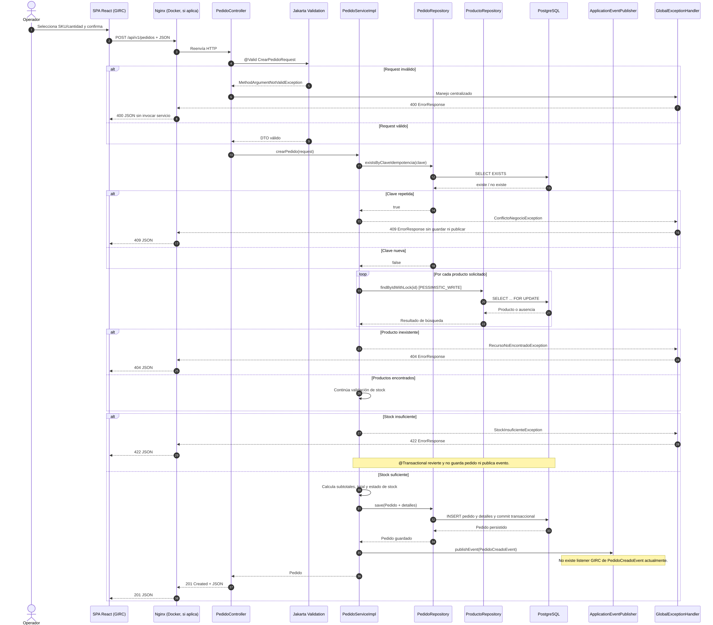

# Diagramas C4 y UML - GIRC

Las figuras SVG se renderizaron desde fuentes Mermaid y se muestran aquí. Cada título enlaza al `.mmd` editable correspondiente.

## C4 Nivel 1 - Contexto

[Fuente Mermaid](diagrams/c4-contexto.mmd)

## C4 Nivel 2 - Contenedores

[Fuente Mermaid](diagrams/c4-contenedores.mmd)

## C4 Nivel 3 - Componentes del backend

[Fuente Mermaid](diagrams/c4-componentes-backend.mmd)

## UML - Clases de dominio

[Fuente Mermaid](diagrams/uml-clases-dominio.mmd)

## UML - Secuencia Full Stack de pedido

[Fuente Mermaid](diagrams/uml-secuencia-crear-pedido.mmd)

## UML - Despliegue

[Fuente Mermaid](diagrams/uml-despliegue.mmd)

