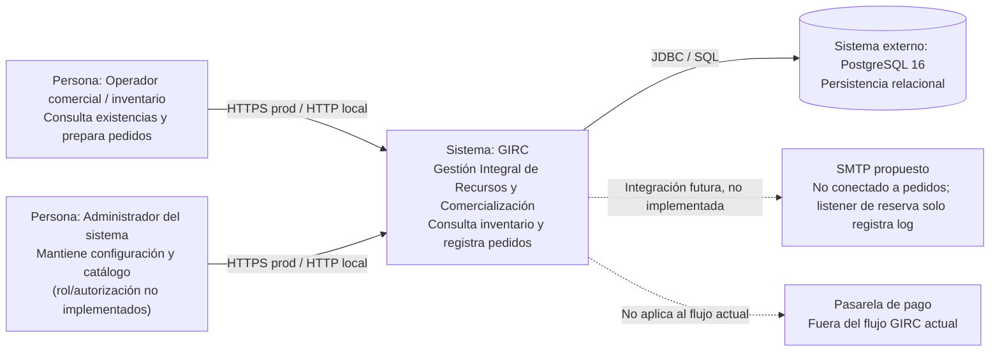
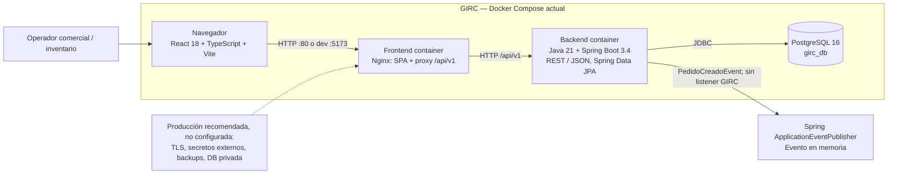
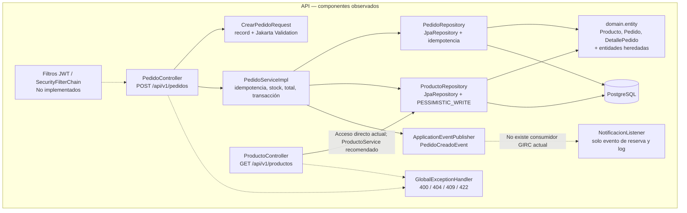
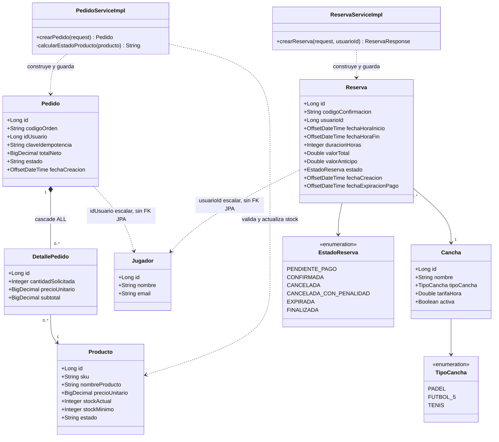
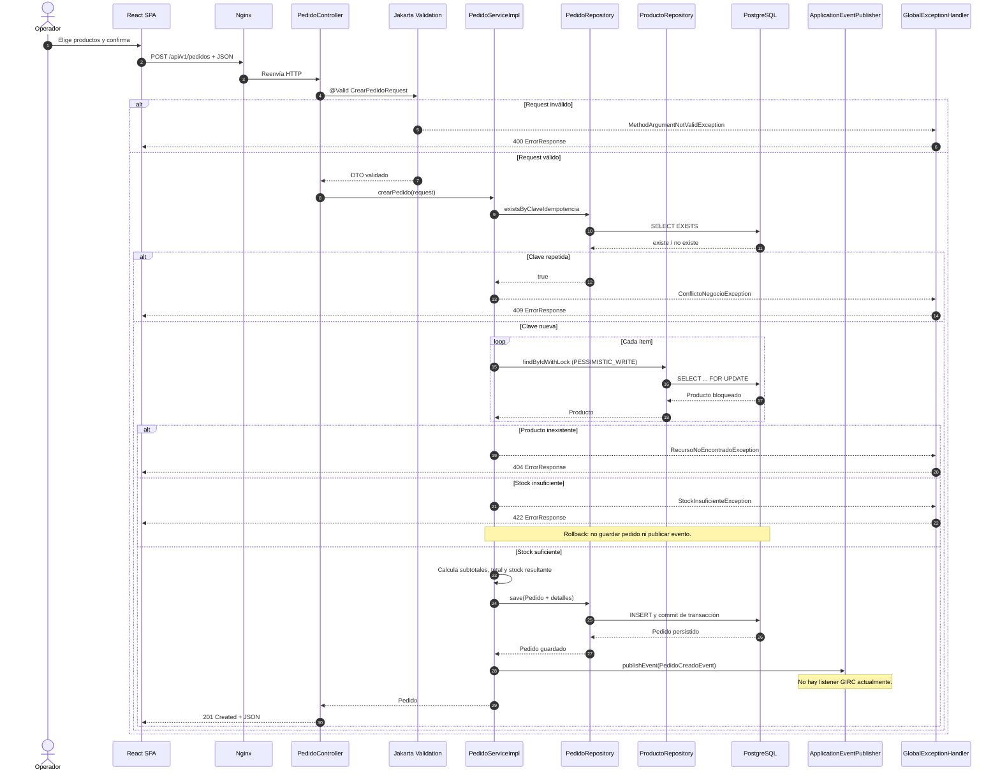
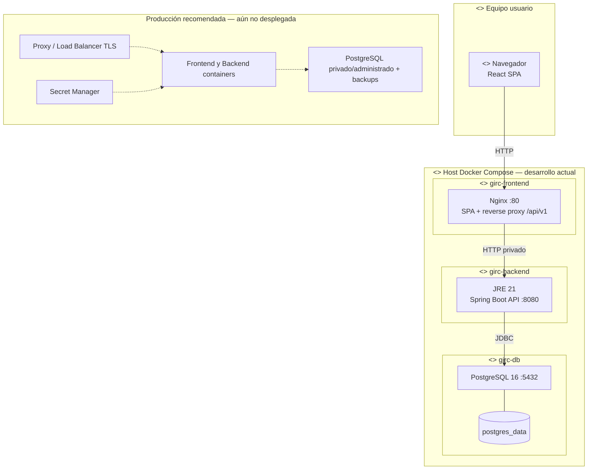

# Diagramas C4 y UML — GIRC

Estos bloques Mermaid se renderizan en GitHub. Las fuentes canónicas editables están en [`diagrams/`](diagrams/).

## C4 Nivel 1 — Contexto

## C4 Nivel 2 — Contenedores

## C4 Nivel 3 — Componentes backend

## UML — Clases de dominio

## UML — Secuencia Full Stack: crear pedido

## UML — Despliegue

